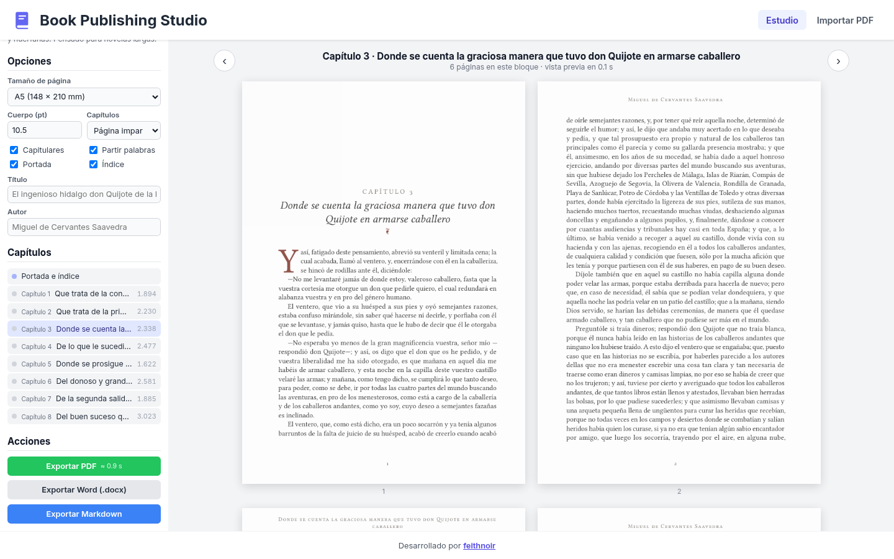
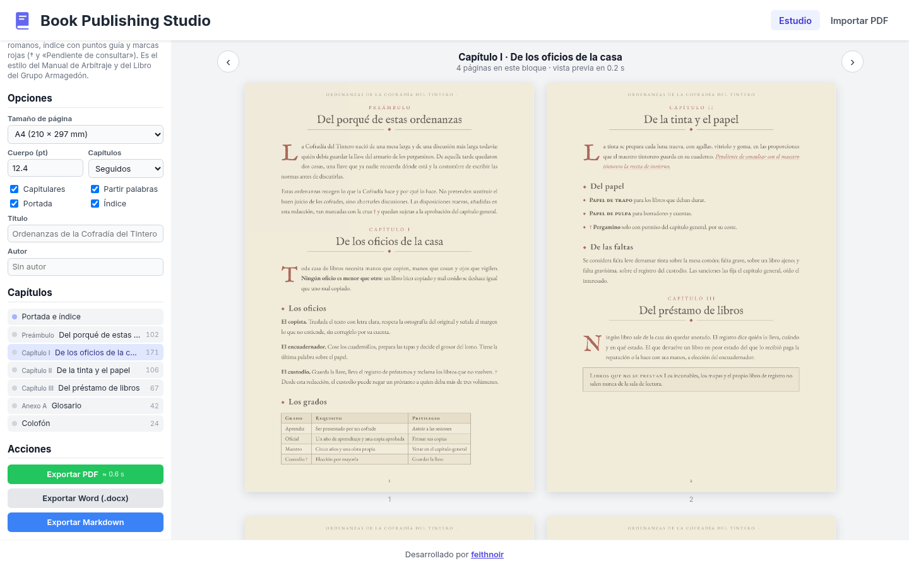
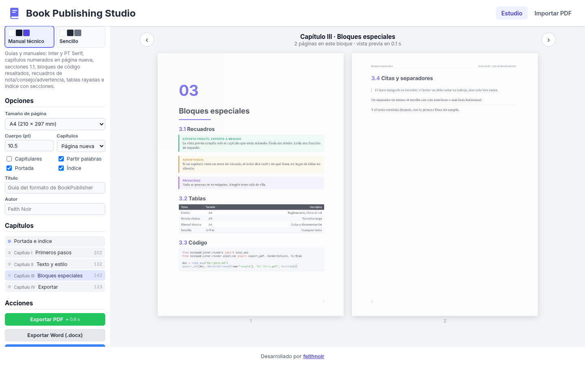
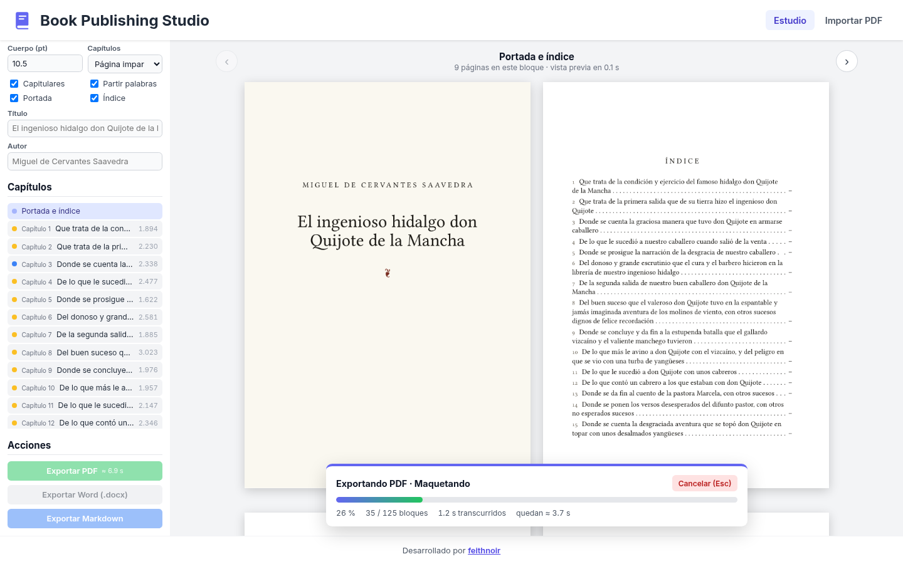
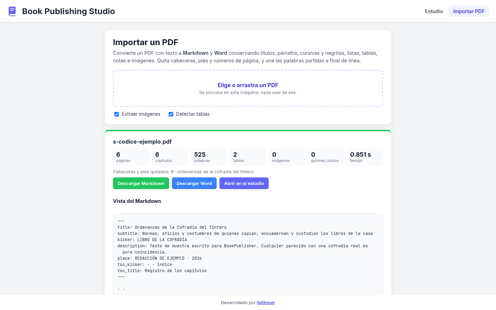

# BookPublisher

Estudio local de maquetación de **libros, novelas, guías y manuales**, hermano de [Magazine Layout Studio](https://github.com/FeithNoir/MagazinePublisher).

* **Importa** un PDF y lo convierte a **Markdown** y **Word**, conservando títulos, párrafos, cursivas y negritas, versalitas, listas, tablas, notas e imágenes, y quitando cabeceras, pies, números de página y palabras partidas.
* **Exporta** Markdown, texto plano o Word a un **PDF de calidad de imprenta** con cuatro temas (y también a Word o Markdown).
* Pensado para **libros largos**: una novela de 680 páginas se exporta en ~2 s, con progreso real, tiempo restante, cancelación inmediata y caché por capítulo (repetir tarda 0,2 s). Ver [rendimiento](docs/files/rendimiento.md).
* **Privado:** todo se procesa en tu máquina.



## Temas

| | |
|---|---|
| **Códice** | Tratado antiguo en pergamino: EB Garamond e IM FELL, versalitas espaciadas, filetes con rombo, capítulos en romanos, capitulares rojas, índice con puntos guía, «†» y «Pendiente de consultar» en rojo. Reproduce el estilo del Manual de Arbitraje y del Libro del Grupo Armagedón. |
| **Novela clásica** | A5, Libertinus Serif justificado con partición silábica, sangrías, capitulares, capítulos en página impar, viudas y huérfanas controladas, cabeceras en versalitas. |
| **Manual técnico** | A4, Inter + PT Serif + JetBrains Mono, secciones numeradas, código resaltado, recuadros de nota/consejo/advertencia, tablas rayadas, índice con secciones. |
| **Sencillo** | 6×9 in, Charis SIL, sin adornos. |

Detalles y cómo crear uno: [docs/files/temas.md](docs/files/temas.md).

| Códice | Manual técnico |
|---|---|
|  |  |

| Exportando 1 026 páginas | Importar PDF |
|---|---|
|  |  |

## Stack

* **Motor (Python 3.11+):** [Typst](https://typst.app) (vía el paquete `typst`, sin instalar nada aparte) para componer; **PyMuPDF** para leer PDF y unir; **python-docx**; **markdown-it-py**; **FastAPI** + SSE para el servidor local.
* **Estudio (Angular 22):** zoneless, standalone, signals; mismo lenguaje visual que Magazine Layout Studio.

Por qué cada pieza y cómo funciona el pipeline por capítulos: [docs/files/architecture.md](docs/files/architecture.md).

## Instalar

Requisitos: Python 3.11 o superior y Node 22.12+ (solo para compilar el estudio).

```bash
git clone https://github.com/FeithNoir/BookPublisher.git
cd BookPublisher
python -m venv .venv && source .venv/bin/activate      # en Windows: .venv\Scripts\activate
pip install -e "engine[dev]"
cd web && npm ci && npx ng build && cd ..
```

## Usar

### Estudio

```bash
bookpublisher serve            # http://127.0.0.1:8765
```

Abre un `.md`, `.txt` o `.docx` (o pega texto), elige tema y opciones, recorre los capítulos con ← → y exporta. En «Importar PDF» conviertes un PDF a Markdown/Word y lo abres en el estudio.

Desarrollo del frontend con recarga en caliente: `bookpublisher serve` en una terminal y `cd web && npx ng serve` en otra (el proxy manda `/api` al motor) → http://localhost:4200.

### Línea de órdenes

```bash
bookpublisher themes
bookpublisher export samples/quijote-ejemplo.md -t novela -o quijote.pdf
bookpublisher export samples/guia-formato.md -t manual
bookpublisher export libro.md -f docx                      # también a Word o Markdown
bookpublisher import documento.pdf --to ambos -o documento # .md (+ imágenes) y .docx
```

Opciones de exportación: `--page-size a4|a5|b5|carta|6x9|5.5x8.5`, `--font-size`, `--chapter-break flow|page|recto`, `--title`, `--author`, `--no-toc`, `--no-cover`, `--no-hyphenate`, `--workers`. Ctrl+C cancela.

### Entrada desde OniriFix

Cadena habitual: corregir el manuscrito con [OniriFix](https://github.com/FeithNoir/OniriFix) y maquetarlo aquí. OniriFix no reescribe un `.pdf` ni un `.docx` en su sitio: el texto corregido sale siempre como Markdown al lado del original.

```bash
# 1. Aplicar L1 + L2 seguras (el PDF/DOCX original no se toca).
onirifix corregir capitulo.pdf --l2-seguras --aplicar --formato md,csv,json,diff,pdf

# Quedan, entre otros:
#   capitulo.corregido.md      ← entrada preferida para BookPublisher
#   manuscrito-corregido.pdf   ← un capítulo por página (opcional)
#   informe.pdf                ← auditoría editorial
```

Si el manuscrito ya es `.md` o `.txt`, OniriFix puede reescribirlo in situ con `--aplicar`; para BookPublisher basta ese mismo archivo.

```bash
# 2a. Línea de órdenes: exportar el mismo capítulo en dos temas.
bookpublisher export capitulo.corregido.md -t novela -o capitulo-novela.pdf
bookpublisher export capitulo.corregido.md -t sencillo -o capitulo-sencillo.pdf

# 2b. Estudio: abre el .md, elige tema y exporta.
bookpublisher serve
```

Si solo tienes el PDF corregido de OniriFix (sin el `.md`):

```bash
bookpublisher import manuscrito-corregido.pdf --to ambos -o capitulo
bookpublisher export capitulo.md -t novela -o capitulo-novela.pdf
```

Notas:

* Prefiere `*.corregido.md` sobre reimportar el PDF: evitas una pasada extra de extracción y conservas mejor la estructura.
* El PDF de OniriFix y el de BookPublisher tienen que llevar capa de texto; un escaneo sin OCR no sirve en ninguno de los dos.
* Ajusta `--page-size`, `--chapter-break` o el tema (`novela`, `sencillo`, `manual`, `codice`) según lo que veas al revisar el PDF.

### Desde Python

```python
from bookpublisher.readers import read_any
from bookpublisher.render.pipeline import RenderOptions, Runtime, export_pdf

if __name__ == "__main__":          # necesario: el motor usa procesos (forkserver/spawn)
    rt = Runtime()
    export_pdf(read_any("libro.md"), RenderOptions(theme="novela"), "libro.pdf", rt,
               progress=print)
    rt.shutdown()
```

## Formato

Markdown con front matter YAML, notas al pie, recuadros `> [!NOTA]`, versalitas `[texto]{.smallcaps}`, capítulos sin número `{.unnumbered}`… Todo en [docs/files/formato-markdown.md](docs/files/formato-markdown.md); la muestra [`samples/guia-formato.md`](samples/guia-formato.md) lo usa todo.

## Documentación

* [Diseño](docs/files/design.md) · [Arquitectura](docs/files/architecture.md) · [Temas](docs/files/temas.md) · [Rendimiento](docs/files/rendimiento.md) · [Formato de entrada](docs/files/formato-markdown.md) · [Importación de PDF](docs/files/importacion.md)

## Muestras y pruebas

`samples/` contiene solo textos de dominio público o escritos para el proyecto: los ocho primeros capítulos de *Don Quijote* (Proyecto Gutenberg), unas ordenanzas ficticias para el tema Códice y la guía del formato. `scripts/quijote_md.py` descarga el *Quijote* completo para pruebas de rendimiento. `docs/refs/` está en `.gitignore` para guardar en local referencias privadas.

```bash
cd engine && pytest              # lectores, escritores, los cuatro temas, caché, cancelación, vista previa, API
python scripts/benchmark.py /tmp/quijote-completo.md --warm
python scripts/screenshots.py --long /tmp/quijote-completo.md   # capturas con Playwright
```

## Licencia

[MIT](LICENSE) © 2026 Feith Noir. Las fuentes incluidas son OFL (`engine/src/bookpublisher/fonts/licenses/`) y el paquete Typst *droplet* es MIT. PyMuPDF se distribuye bajo AGPL-3.0: si redistribuyes BookPublisher junto con PyMuPDF, ese conjunto queda sujeto a la AGPL (ver [arquitectura](docs/files/architecture.md#por-qué-este-stack)).
